# Smart Attendance Management System

A digital employee attendance management application built with Java 17,
Spring Boot 3.2, Hibernate/JPA, MySQL 8, JSP, React 18, and Apache
Tomcat 10.1. It supports administrator, manager, and employee workflows
for attendance, leave and work-from-home requests, project teams,
QR-based check-in/check-out, and scheduled email reminders.

## 📌 About the Project

The **Smart Attendance Management System** brings employee attendance
and related workflows together in one application. Managers and
employees work with shared MySQL records, so updates such as leave
decisions, work-from-home requests, employee details, and project-team
changes are reflected across the relevant dashboards.

## 🎯 Objectives

-   Organize employee and attendance information in a centralized
    database.
-   Support attendance check-in and check-out using employee QR codes.
-   Allow employees to submit leave and work-from-home requests.
-   Help managers review attendance and approve or reject requests with
    remarks.
-   Provide administrators with employee management tools.
-   Send scheduled email reminders for upcoming shifts and missed scans.

## ✨ Features

## 📸 Screenshots

### 🔐Login Page
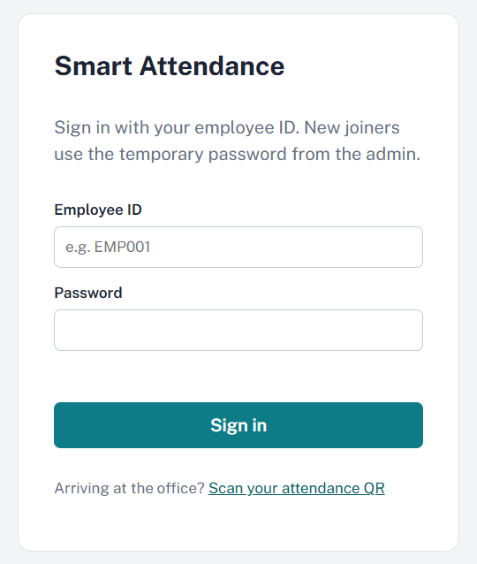

### 👨‍💼Admin Dashboard
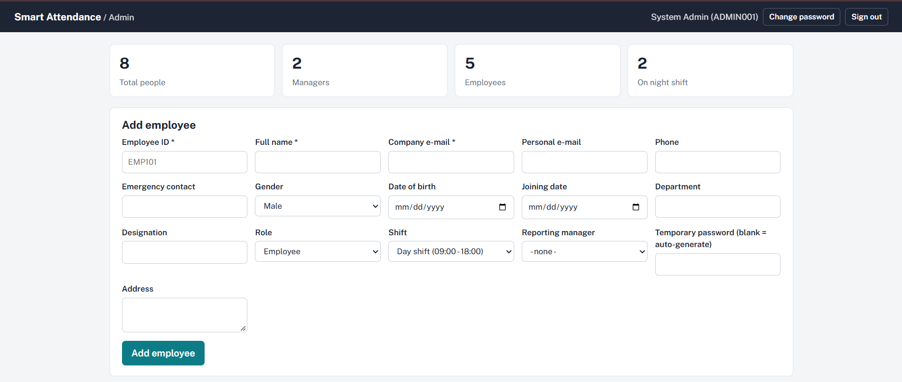
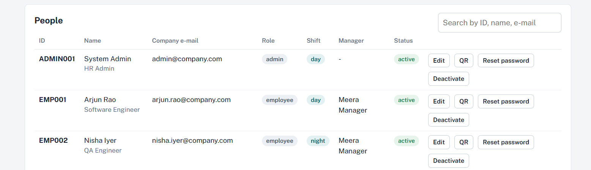

### 👨‍💼Manager Dashboard
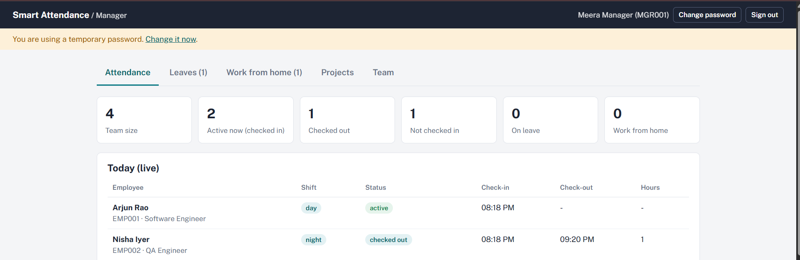
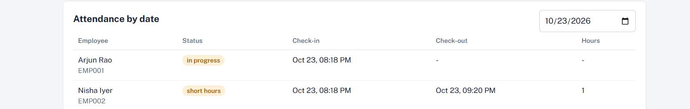
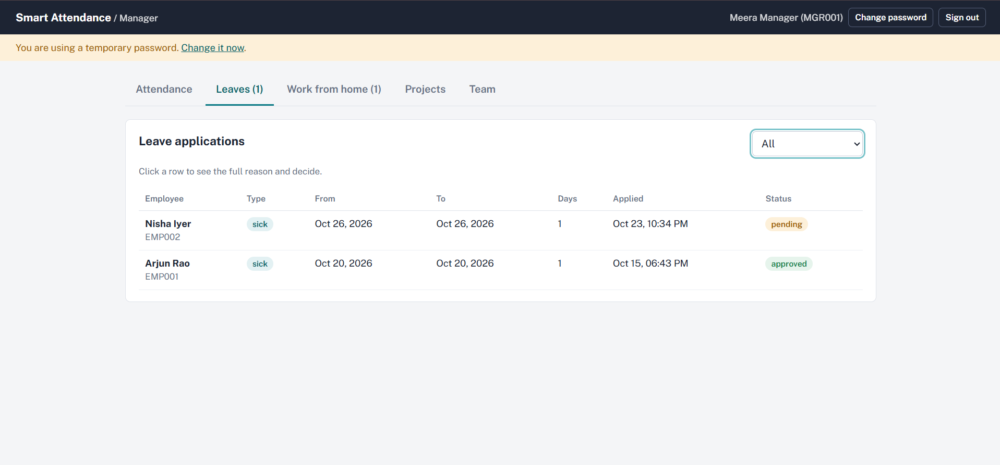
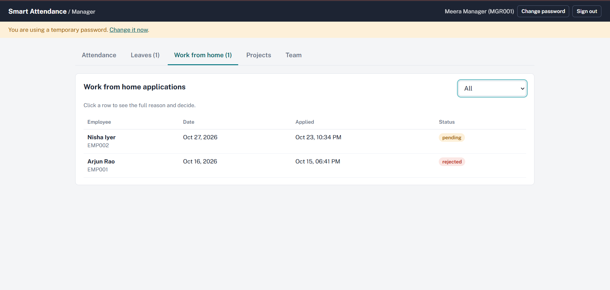
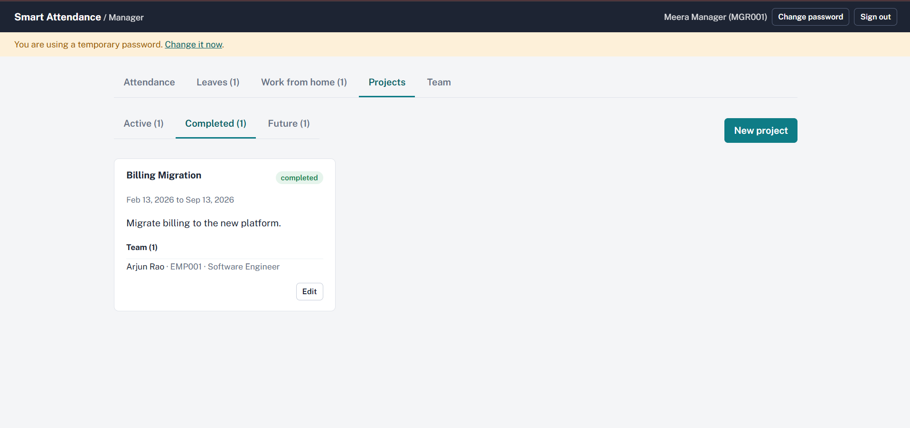
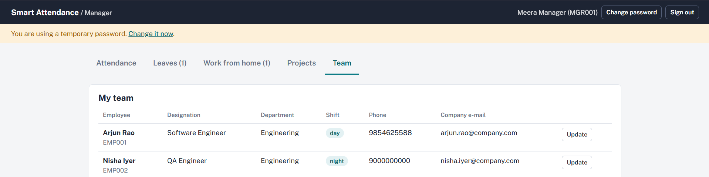


### 👨‍💻Employee Dashboard
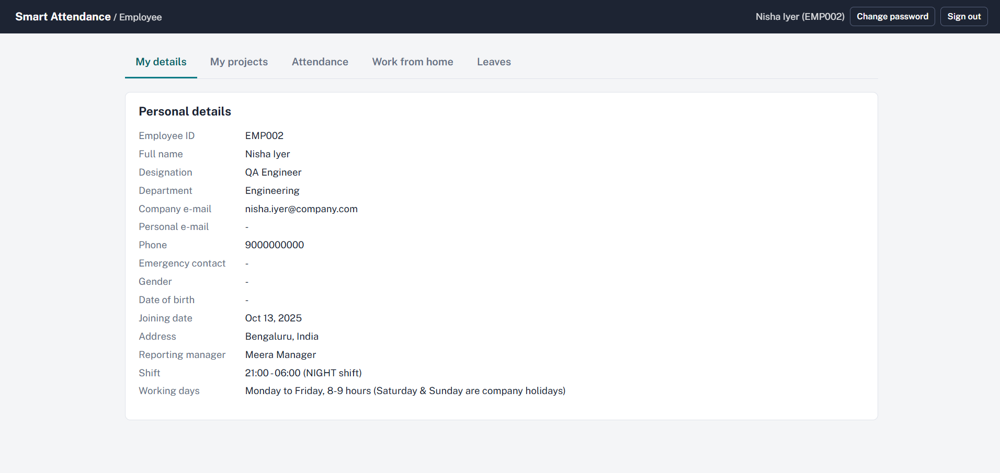
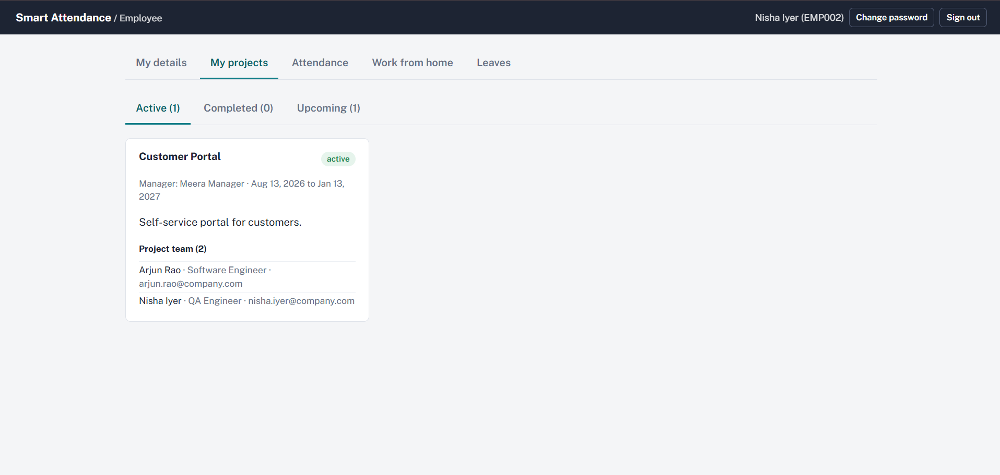
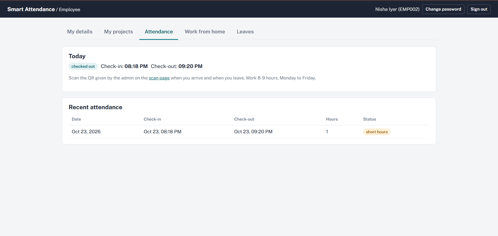
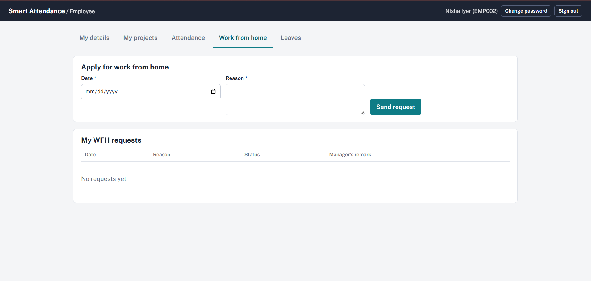
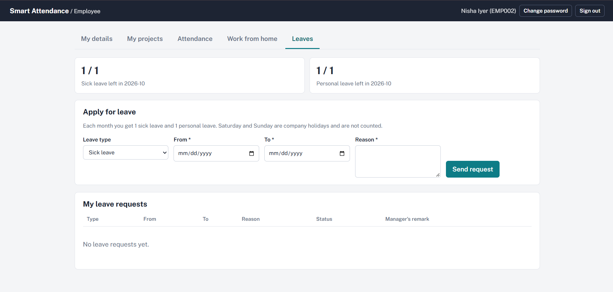


### 📱QR-Based Attendance
Administrator QR Code

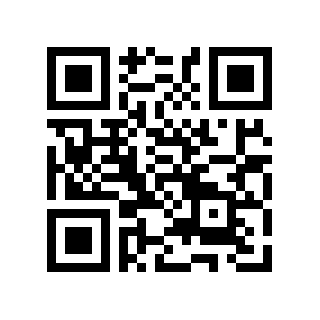

Employee QR Code — Day Shift

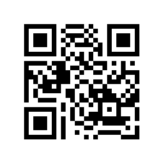

Employee QR Code — Night Shift

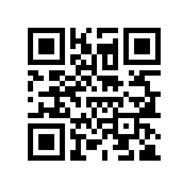

Manager QR Code

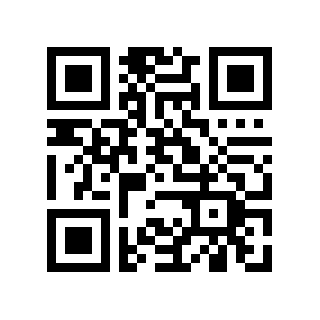


### 👨‍💼 Administrator

-   Add and edit employee details, including contact information,
    department, designation, role, shift, and reporting manager.
-   Generate and download employee QR codes as PNG files.
-   Reset temporary passwords and activate or deactivate employee
    accounts.
-   Temporary passwords are shown once and sent by email.

### 🧑‍💼 Manager

-   View attendance status, including check-in/check-out, active
    employees, employees on leave, employees working from home, and
    employees who have not checked in.
-   Review attendance by date.
-   Review leave and work-from-home requests and record decisions with
    remarks.
-   Create and edit projects grouped as Active, Completed, or Future.
-   Manage project teams and team details.

### 👩‍💻 Employee

-   View personal details, shift timing, projects, and attendance
    history.
-   Submit leave requests and work-from-home requests.
-   View request decisions and manager remarks.
-   The configured leave allowance is one sick leave and one personal
    leave per month; weekends are not counted.

### 📱 QR-Based Attendance

-   Open the `/scan` page on an office tablet or phone and scan the QR
    code generated for an employee.
-   The first scan records check-in; the second scan records check-out.
-   A work duration of at least eight hours is marked `PRESENT`; a
    shorter duration is marked `SHORT_HOURS`.
-   For night shifts, scans after midnight belong to the previous day.
-   Camera scanning requires HTTPS or `localhost`; manual entry is
    available as a fallback.

### 📧 Scheduled Email Reminders

A scheduler runs every five minutes on weekdays (Monday--Friday) and
sends reminders to the employee's company email address: - `PRE_SHIFT`:
30 minutes before shift start when there is no approved
leave/work-from-home request and no scan. - `MISSED_SCAN`: 15 minutes
after shift start if there is still no scan, approved leave, or
work-from-home request. - Each reminder is sent once per employee per
day.

Shift times and reminder windows can be configured in
`application.properties`, including `app.shift.day.start`,
`app.shift.night.start`, and `app.reminder.*`.

## 🛠️ Technologies Used

-   **Java:** 17
-   **Backend:** Spring Boot 3.2, Spring MVC, REST controllers
-   **Persistence:** Hibernate, Spring Data JPA
-   **Database:** MySQL 8
-   **Views:** JSP
-   **Frontend:** React 18, ReactDOM, Babel
-   **Application server:**Apache Tomcat 10.1 for deployment
-   **Build tool:** Maven 3.9+

## 🧩 How the Architecture Works

  -----------------------------------------------------------------------
  Layer                               Responsibility
  ----------------------------------- -----------------------------------
  MySQL                               Stores employee, project,
                                      attendance, leave, and
                                      work-from-home records

  Hibernate / Spring Data JPA         Maps Java entities to MySQL tables;
                                      `ddl-auto=update` creates or
                                      updates tables

  Spring Boot REST controllers        Provides API endpoints under
                                      `/api/admin`, `/api/manager`,
                                      `/api/employee`, `/api/attendance`,
                                      and `/api/auth`

  JSP                                 Serves page shells for the admin,
                                      manager, employee, login, and scan
                                      pages from `WEB-INF/jsp`

  React                               Powers the three dashboards, calls
                                      the REST API with `fetch`, and
                                      refreshes data every 10--20 seconds

  Tomcat                              Runs the application embedded
                                      during development or as a WAR on
                                      external Tomcat 10.1
  -----------------------------------------------------------------------

## ⚙️ Prerequisites

Install the following before running the application:

-   JDK 17
-   Maven 3.9 or later
-   MySQL 8
-   A modern web browser

## 🚀 Installation and Setup

### 1. Clone the repository

``` bash
git clone https://github.com/vivekanandpuranikamath/Smart-Attendance-Management-System.git
cd Smart-Attendance-Management-System
```

If the project is already on your computer, open its existing project
directory instead of cloning it again.

### 2. Configure database credentials

The application uses the `smart_attendance` database, which is created
automatically. The file `database/schema.sql` is optional.

Set the database environment variables before starting the application.
The following commands use Bash syntax:

``` bash
export DB_USER=root
export DB_PASSWORD=your_mysql_password
```

Replace `your_mysql_password` with your local MySQL password in your
terminal only. Do not put real passwords or credentials in this README
or commit them to GitHub.

### 3. Configure email alerts (optional)

To enable email reminders, set your email account credentials as
environment variables:

``` bash
export MAIL_USERNAME=you@example.com
export MAIL_PASSWORD=your_email_app_password
```

Use your email provider's recommended credentials, such as an app
password when required. Keep credentials private. The default SMTP host
is Gmail; update the relevant `spring.mail.*` settings in
`application.properties` if you use another mail provider.

### 4. Run the application

From the project root, run:

``` bash
mvn spring-boot:run
```

Once the application starts successfully, open your browser and visit:

**http://localhost:8080/smart-attendance/**

## Login credentials

ADMIN001 - Admin001@123

MGR001 - Manager@123

EMP001 - Employee@123

## 🖥️ Deploy to External Apache Tomcat 10.1

Build the WAR package:

``` bash
mvn clean package
```

Copy `target/smart-attendance.war` into the external Tomcat `webapps`
directory, start Tomcat, and open:

**http://localhost:8080/smart-attendance/**

Set the required environment variables before starting Tomcat.

## 🔐 Demo Accounts and Security

Demo accounts are created on first startup. The configured roles include
an administrator, a manager, a day-shift employee, and a night-shift
employee.

For security, this README does not publish demo passwords. Review the
application's initialization/configuration to confirm the current demo
account details, change default credentials before deployment, and never
use demo credentials in production.

Because this repository is public: - Do not commit `.env` files,
passwords, API keys, database credentials, or email credentials. - Do
not commit real employee details or attendance records. - Review source
files and Git history for secrets before pushing. Removing a secret from
the latest file does not remove it from previous commits; rotate any
exposed credentials.

## 📝 Important Notes

-   Camera-based QR scanning requires HTTPS or `localhost`; manual entry
    is available as a fallback.
-   React, ReactDOM, and Babel load from cdnjs, so the browser needs
    internet access. No npm build step is required for these frontend
    scripts.
-   The current Hibernate setting `spring.jpa.hibernate.ddl-auto=update`
    updates the schema. Once the schema is stable for production, review
    and change it to `validate` as appropriate for your deployment
    process.

## 🔮 Future Enhancements

Possible future improvements, depending on project requirements: -
Attendance analytics and dashboard summaries. - Exportable attendance
reports. - Additional leave-management workflows. - More configurable
notification channels and schedules. - Production-ready deployment
configuration and automated tests.

## 🤝 Contributing

Suggestions and improvements are welcome. Before submitting changes,
test them locally and ensure no credentials or private employee data are
included.

1.  Fork the repository.
2.  Create a branch for your change.
3.  Commit your changes with a clear message.
4.  Open a pull request describing what changed.

## 📄 License

No license has been specified yet. Add a suitable license if you want to
define how others may use, modify, or distribute this project.

## 👨‍💻 Author

**Vivekanand Puranikamath**

GitHub:
[@vivekanandpuranikamath](https://github.com/vivekanandpuranikamath)


